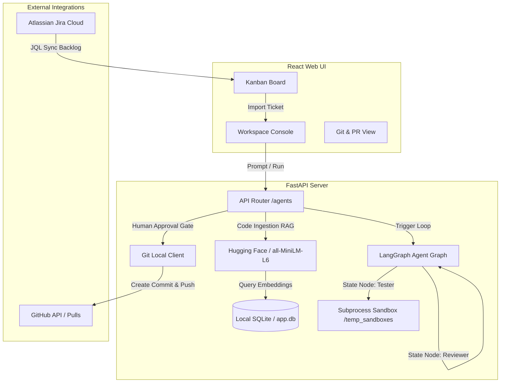

# AI Software Engineering (SWE) Agent Platform 🚀

The **AI SWE Agent Platform** is an autonomous developer workspace inspired by Devin and OpenHands. It links **Jira Cloud** user stories and **GitHub** remote code bases, automating requirement analysis, task checklist planning, code authoring, sandbox testing, and Pull Request registration through a human-in-the-loop approval workflow.

---

## 🏗 Architecture Diagram

Below is the conceptual architecture mapping the data flow from requirement ingestions to GitHub Pull Request delivery:



---

## 🌟 Key Features

- **LangGraph Multi-Agent Loops**: Orchestrates developer workloads via cooperating node nodes: **Planner**, **Coder**, **Tester**, and **Reviewer**.
- **Codebase RAG (SQLite + Hugging Face)**: Splits code files and builds local vector indices using the SentenceTransformer `all-MiniLM-L6-v2` CPU model, eliminating massive context window loads.
- **Isolated Subprocess Sandbox**: Runs unit tests (`pytest`) and compile evaluations (`py_compile`) inside isolated workspace folders to guarantee code safety.
- **Human Gate Approval**: Displays a clean code diff view allowing developers to review changes before committing.
- **GitHub & Jira Cloud Integration**: Syncs backlog tickets, auto-imports requirements, pushes patch branches, and opens Pull Requests.

---

## ⚙ Environment Variables Setup (`.env`)

Create a file named `.env` inside the [backend/](file:///d:/AI_Software_Engineering_Agent/backend) folder and add:

```env
# 1. LLM API Key (Required for live agent runs using the "Live GPT-4o" option)
OPENAI_API_KEY=your_openai_api_key_here

# 2. GitHub Access Token (Required for pushing code and creating PRs)
# Generate a token with 'repo' scope at: https://github.com/settings/tokens
GITHUB_TOKEN=your_github_token_here

# 3. Jira Cloud credentials (Optional - falls back to offline json db if blank)
JIRA_URL=https://your-domain.atlassian.net
JIRA_EMAIL=your-account-email@company.com
JIRA_API_TOKEN=your_jira_token_here
JIRA_PROJECT_KEY=KAN
```

---

## 🚀 Getting Started

Ensure you have **Python 3.10+** and **Node.js 18+** installed.

### 1. Running the FastAPI Backend
1. Open a terminal and navigate to the backend folder:
   ```bash
   cd backend
   ```
2. Create a virtual environment and activate it:
   ```bash
   python -m venv .venv
   # On Windows:
   .venv\Scripts\activate
   # On Unix/macOS:
   source .venv/bin/activate
   ```
3. Install Python dependencies:
   ```bash
   pip install -r requirements.txt
   ```
4. Run the Uvicorn dev server:
   ```bash
   uvicorn app.main:app --reload
   ```
The backend API documentation is now live at `http://127.0.0.1:8000/docs`.

### 2. Running the React Frontend
1. Open a new terminal window and navigate to the frontend folder:
   ```bash
   cd frontend
   ```
2. Install package dependencies:
   ```bash
   npm install
   ```
3. Start the Vite development site:
   ```bash
   npm run dev
   ```
The dashboard is now live at `http://localhost:5173`.

---

## 💻 Docker Compose Deployment (Alternative)

To build and run both services together using Docker:
1. Ensure Docker Desktop is running.
2. In the project root directory, run:
   ```bash
   docker-compose up --build
   ```
This will start the backend at port `8000` and the frontend dashboard at port `80`.
